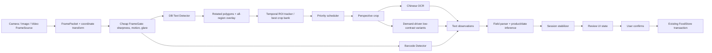
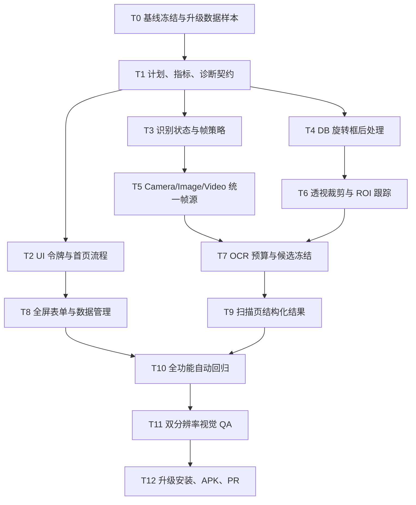

# 食期管家 APK 重构计划（2026-07-29）

## 1. 目标与结论

本次不是单纯换颜色，而是同时处理三个根因：

1. **界面层过载**：`MainActivity.java` 约 4,578 行，首页、筛选、提醒、导入导出、表单、CRUD 和弹窗全部混在同一个类中。
2. **识别层过载**：`DateOcrScanActivity.java` 约 7,727 行，相机生命周期、视频解码、帧筛选、条码、多个 OCR 引擎、低对比度增强、字段推理、候选稳定和界面渲染相互耦合。
3. **文字定位不完整**：当前 DB 检测后处理把轮廓直接转换为水平 `boundingRect`，缺少 PaddleOCR 官方流程中的旋转最小外接框、文字框扩张和透视矫正，因此斜置、弯曲、细小、低对比度文字容易漏框或截断。

改造采用“**行为先抽离、界面再收敛、识别按阶段替换**”的路线。不会一次性迁移到 Compose，也不会改变现有本地数据格式后直接覆盖。每个阶段都必须能够独立构建、安装、升级和回滚。

## 2. 已完成的现状审计

### 2.1 真实视觉问题

已查看现有 APK 的实际运行截图，而不是仅根据代码推测：

- 首页同时铺开“拍照识别、扫码、手动记录、Excel 导入、Excel 导出、JSON 换机”等按钮，首屏操作层级不明确。
- 搜索、筛选、提醒、统计和库存卡片纵向堆叠，常用操作与低频数据工具竞争注意力。
- 扫描页上方是文字按钮和状态块，下方固定占用约 60% 屏幕的结果面板；结果以多段说明文字为主，遮挡相机画面。
- 识别框与候选文字同时频繁变化，用户无法判断“已经看清”“正在识别”还是“结果已稳定”。
- 补货仍是长弹窗，日期、数量、状态和说明缺少清晰分组，底部操作需要长距离滚动。

视觉证据位于：

- `docs/qa/screenshots/2026-07-28-v0316/06-upgrade-data-preserved.png`
- `docs/qa/screenshots/2026-07-28-v0316/01-live-text-regions.png`
- `docs/qa/screenshots/2026-07-28-v0316/02-recognition-result.png`
- `docs/qa/screenshots/2026-07-28-v0316/07-restock-date-scroll.png`

### 2.2 当前识别瓶颈

- 单帧处理会创建多种整图和固定区域变体，再同时调用 ML Kit 中文、ML Kit 拉丁、ZXing、ML Kit 条码、Paddle 棒状文字识别和 Paddle DB 检测。
- 低对比度恢复会在多轮中重复生成激光、拓印、双向笔画、二值化和反色图，工作量随帧数快速增长。
- 检测结果先按“疑似日期”的位置/宽高规则排序并截断，因此“显示所有文字框”和“优先识别日期”被错误地绑定在一起。
- 视频使用固定时间比例与样本相关裁剪；相机则使用另一套条件，两者没有共享统一的帧源和会话语义。
- 当前候选稳定器能减少部分抖动，但上游每帧输入集合变化太大，导致稳定结果仍会反复替换。

### 2.3 必须保留的能力

- 本地库存、批次唯一编号和升级数据兼容。
- 条码与多个商品模板、商品与多个批次之间的多对多可能性。
- `-1`、补货、编辑、删除等高频库存操作。
- 生产日期 + 保质期、直接有效期两种日期模式。
- 智能/固定提醒，并且智能提醒只在新增或影响提醒的状态变化时重新计算。
- Excel 批量导入导出与 JSON 快速换机。
- OCR 结果先展示依据与结构化字段，用户确认后才能写入。

## 3. 调研结论与技术选择

### 3.1 Android 架构

Android 官方建议 UI 遵循单向数据流，屏幕状态由状态持有者生产，复杂可复用 UI 使用独立的普通状态类。当前两个 Activity 同时持有业务状态、异步任务和视图，正是需要拆分的形态。

本项目先采用 Java 可渐进落地的状态持有者和控制器，不在同一个 PR 中强制 Kotlin/Compose 全量迁移。Material Views 在 2026 年已进入维护模式，因此第一阶段用资源化设计令牌和可复用 View 组件稳定行为；完成领域层拆分后，再单独评估 Compose 页面迁移。

### 3.2 相机与逐帧分析

CameraX 官方建议实时分析使用 `STRATEGY_KEEP_ONLY_LATEST`，分析器处理不过来时丢弃旧帧，而不是积压。`FocusMeteringAction` 可以把 AF/AE/AWB 测光区域绑定到用户点击或文字区域，并允许在短时锁定后恢复连续自动对焦。

新的相机会话遵循：

- 预览始终优先，不让 OCR 队列阻塞相机。
- 便宜的画质/运动检测可以高频运行。
- 文字检测按时间预算运行，而不是按每一帧运行。
- 文字框稳定后，把最佳文字区域作为对焦/测光目标；锁定结束后恢复连续 AF。
- UI 坐标与分析坐标通过 CameraX 变换矩阵统一，不再手写多套比例换算。

### 3.3 中文包装文字定位与识别

PaddleOCR 官方 DB 后处理不是简单水平框：

1. 概率图阈值化。
2. 轮廓候选。
3. 最小旋转外接框。
4. 框内平均分过滤。
5. 按面积/周长计算扩张距离进行 unclip。
6. 再次求旋转框并进行透视裁剪。
7. 把矫正后的行图送入中文识别模型。

PP-OCRv6 small detector约 9.6 MB，官方定位为兼顾准确率与效率的移动端模型，现有 APK 已包含对应检测模型，因此第一步应修正后处理和调度，而不是继续叠加新模型。

低对比度喷码只对“已经定位到、但局部对比度不足”的 ROI 按需运行 CLAHE、黑帽/顶帽和少量自适应二值化。OpenCV 官方说明 CLAHE 会在局部网格内均衡并限制噪声放大；它不能作为每帧整图默认步骤。

### 3.4 视频定位

视频不是生产用户入口，而是确定性的回归适配器。CameraX 帧和视频帧都应转换为同一种 `FramePacket` 后进入同一个会话。视频取帧使用时间窗口、场景变化和清晰度择优，不再写固定“70%-88%”样本区间。需要升级解码器时优先采用 Android 官方 Media3 `FrameExtractor`，并使用降采样与非精确 seek 降低解码成本。

## 4. 目标体验

### 4.1 首页

首屏只保留两条主路径：

- **智能识别**：同一入口自动识别条码、包装名称、生产日期、保质期/有效期。
- **手动新增**：识别失败时的稳定后备路径。

其他入口安排：

- “扫码找商品”紧邻搜索，是查库存而不是新增。
- Excel 与 JSON 合并为“数据管理”，从标题栏或更多菜单进入。
- 提醒设置进入首页摘要条，不再占用独立大卡片。
- 库存项固定显示 `-1`、补货和更多操作，不隐藏高频按钮。

### 4.2 新增/编辑/补货

- 从长弹窗改为全屏表单。
- 分为“商品”“日期与批次”“存放与提醒”三个连续区段。
- 日期模式使用分段控件：“生产日期 + 保质期” / “直接有效期”。
- 补货复用商品模板，但始终创建或更新明确的批次 ID；生产日期和保质期不继承为不可编辑常量。
- 底部保存按钮固定，离开前保留草稿或明确确认，避免相机/识别依据返回时丢失。

### 4.3 扫描页

- 相机全屏，顶部仅保留返回、闪光灯、帮助/诊断图标。
- 中央实时绘制所有检测到的文字区域；高价值区域用强调色，普通文字用弱色。
- 画面只显示一个短状态：“请靠近”“正在对焦”“已找到文字”“日期已稳定”。
- 底部结果面板默认紧凑，只显示商品名、条码、生产日期、保质期/有效期四个结构化字段。
- 候选稳定后冻结预选，不再随每帧变动；用户可展开证据并改选其他候选。
- 只有达到可填写状态时启用“核对并填入”，仍不直接保存库存。

## 5. 目标识别架构



核心约束：

- **检测集合与识别工作集分离**：所有有效文字框可显示；每轮只识别少量新出现或明显变清晰的框。
- **按 ROI 缓存**：同一区域若没有更清晰的新帧，不重复识别。
- **按宽高比分桶批处理**：减少不同比例文字行被统一拉伸造成的识别损失。
- **字段稳定后冻结**：除非出现置信度显著更高且通过日期合理性约束的新证据，否则不替换当前预选。
- **日期合理推理**：无标签双日期按较早/较晚推断生产/有效期；单日期结合当前日期、保质期提示和有效期提示判断；无合理证据绝不默认“无过期时间”。

## 6. 类与模块拆分

计划新增或迁移：

```text
ui/
  AppUiTokens
  HomeScreenView
  InventoryItemView
  FoodFormScreen
  DataManagementDialog
  scan/RecognitionScanView
recognition/
  session/RecognitionSessionController
  session/RecognitionUiState
  frame/FramePacket
  frame/FrameSource
  frame/RecognitionFramePolicy
  frame/TemporalRoiTracker
  detection/DbTextPostProcessor
  detection/DetectedTextRegion
  ocr/TextRecognitionScheduler
  fusion/RecognitionFusionEngine
```

迁移期间包路径可先保持 `com.shiqi.expirytracker`，避免一次性改动全部引用；稳定后再按子包移动。

## 7. 有向任务图与最快路线

采用 DAG 的拓扑调度。每次把入度为 0 且验收前置已满足的任务放入任务池；同一工作区不并行修改同一超大 Activity，避免冲突。关键路径使用“剩余最长路径优先”，测试和视觉验收是显式节点，不允许作为开发任务的附注跳过。



当前关键路径：`T0 -> T1 -> T4 -> T6 -> T7 -> T9 -> T10 -> T11 -> T12`。

## 8. 分阶段开发、测试、上传流程

### 阶段 A：基线与骨架

开发：

- 固化现有视频、图片、条码、Excel、JSON 和升级数据样本。
- 新增识别阶段计时、区域数量、OCR 次数和首个可用结果时间指标。
- 把首页设计令牌、数据管理入口和识别帧调度抽成独立类。

测试：

- 现有本地逻辑测试必须 0 失败。
- 原始 APK 与新 APK 使用同一数据快照验证批次 ID、数量、状态不变。
- 输出改造前性能基线。

上传：

- 一个可独立审查的 PR；不得混入模型替换。
- PR 包含改造前后首页与扫描页截图。

### 阶段 B：文字检测与裁剪

开发：

- 按 PaddleOCR DB 后处理迁移旋转框、box score、unclip 和透视裁剪。
- 返回所有通过最低质量门槛的文字框；优先级只影响 OCR 调度。
- 为低对比度 ROI 增加按需增强，不对整帧穷举。

测试：

- 人工标注的关键帧文字区域召回率。
- 旋转、竖排、透视、低对比度样本的裁剪快照。
- 所有用户视频逐个回归，至少读到人工肉眼可见的关键字段。

上传：

- 单独 PR，附每个样本的检测框、最佳裁剪、文本和耗时。

### 阶段 C：实时会话与候选稳定

开发：

- 统一 Camera/Image/Video `FrameSource`。
- 引入 ROI 跟踪、最佳帧保留、宽高比分桶批处理和识别预算。
- 生产相机优先；视频仅复用同一管线做回归。
- 把条码、名称、日期证据融合为单一稳定候选。

测试：

- 首个文字框、首个文字结果、首个可填写结果三段延迟。
- 预览帧率、分析队列、内存和温升。
- 候选稳定后替换次数不超过 1 次；弱证据不得覆盖强证据。

上传：

- 单独 PR，附真机诊断日志格式和视频确定性回归报告。

### 阶段 D：界面与流程

开发：

- 首页、扫描、全屏表单、补货和数据管理统一视觉语言。
- 识别依据作为当前扫描会话的子页面/展开层，返回不销毁当前候选。
- 保留 `-1` 和补货外露。

测试：

- 720x1280、1080x2400、系统字体 1.0/1.3 倍。
- 点击目标至少 48dp，文本不截断、不遮挡。
- 添加、识别、修改、删除、补货、Excel、JSON 全流程。

上传：

- 单独 PR，必须有每个主要状态的实机或 AVD 截图。

### 阶段 E：模型评估与收尾

开发：

- 只有在修复后处理和调度仍达不到指标时，才比较 PP-OCRv6 small/medium 或其他可离线部署模型。
- 以相同验证集比较召回、字符准确率、延迟、内存和 APK 大小。
- 最多保留关键提升显著的少数模型，总 APK 小于 1 GB。

测试与上传：

- 模型选择报告必须包含逐样本差异，不允许只给平均分。
- 最终安装包执行签名升级、数据保留和完整用户旅程。

## 9. 验收指标

自动化指标：

- 本地 Java 逻辑测试：0 失败。
- Gradle `assembleDebug`：成功。
- OCR 分析队列：最多 1 个正在处理帧，不积压旧帧。
- 同一稳定 ROI：没有更清晰帧时不重复 OCR。
- 数据升级：食品 ID、批次 ID、数量和状态逐项一致。

设备相关指标（在目标真机上确认，不用 AVD 冒充）：

- 相机预览主观流畅，目标为不低于 24 FPS。
- 首个文字框目标 <= 500ms。
- 首个可用文字目标 <= 1.5s。
- 首个可填写日期/条码/名称目标 <= 2.5s；未找到时必须给出可理解的当前阶段。
- 文字区域召回率、日期字段召回率、名称准确率分别统计，不以“商品新增成功”一个指标代替。

视觉指标：

- 首屏不出现六个同权重操作按钮。
- 扫描预览至少保留屏幕高度的 55%。
- 结果面板只显示结构化字段和一个主要动作，诊断信息默认隐藏。
- 所有主要页面通过 720x1280 与 1080x2400 截图检查。

## 10. 数据安全与回滚

- 不删除或重用现有字段；新字段提供默认值。
- 批次 ID 继续作为 JSON 合并和补货更新的主键。
- 每次结构迁移先读取、复制、验证，再原子写入；保留最近备份。
- 识别会话只产生草稿，不直接调用 `FoodStore.saveFoods`。
- 每个阶段的 PR 可独立回滚，模型文件与数据迁移不得在同一个高风险提交中同时变化。

## 11. 第一批实施范围

本分支先落地可独立验收的第一批：

1. 建立本计划、任务边界和验收指标。
2. 抽出可单测的识别帧预算/阶段策略，开始移除 Activity 内的硬编码视频区间。
3. 将 DB 检测结果升级为旋转文字框，并为透视裁剪预留稳定 API。
4. 精简首页：主操作收敛，Excel/JSON 合并到“数据管理”。
5. 调整扫描页信息层级，结构化显示识别字段，减少结果面板遮挡。
6. 增加逻辑测试、构建、视频回归和双分辨率视觉 QA。

## 12. 主要资料

- [Android 架构建议](https://developer.android.com/topic/architecture/recommendations)
- [Android UI state holders](https://developer.android.com/topic/architecture/ui-layer/stateholders)
- [CameraX 图像分析与最新帧策略](https://developer.android.com/media/camera/camerax/analyze)
- [CameraX 配置、对焦与测光](https://developer.android.com/media/camera/camerax/configuration)
- [MlKitAnalyzer 坐标变换](https://developer.android.com/reference/androidx/camera/mlkit/vision/MlKitAnalyzer)
- [ML Kit Android 文字识别](https://developers.google.com/ml-kit/vision/text-recognition/v2/android)
- [PaddleOCR 官方 DB 后处理源码](https://github.com/PaddlePaddle/PaddleOCR/blob/main/ppocr/postprocess/db_postprocess.py)
- [PaddleOCR 移动端部署与参数](https://github.com/PaddlePaddle/PaddleOCR/blob/main/deploy/lite/readme.md)
- [PaddleOCR PP-OCRv6 模型说明](https://www.paddleocr.ai/main/en/index.html)
- [DBNet 原始论文](https://arxiv.org/abs/1911.08947)
- [OpenCV CLAHE 说明](https://docs.opencv.org/master/d2/d74/tutorial_js_histogram_equalization.html)
- [Android Media3 视频取帧](https://developer.android.com/media/media3/inspector/extract-frames)
- [Android Views 无障碍与 48dp 触控目标](https://developer.android.com/guide/topics/ui/accessibility/views/apps-views)
