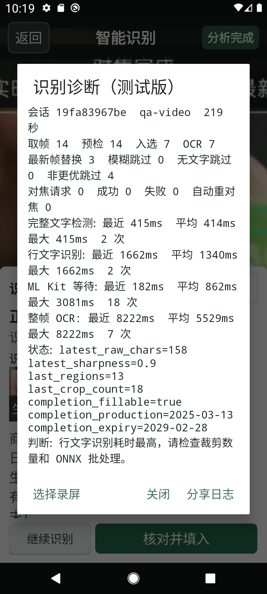

# V0.3.17 相机与 OCR 诊断版验收

日期：2026-07-28

## 输入

- 用户录屏：`Record_2026-07-28-16-46-03_e7c84e4b72b45d7acf770bbb7219e5ff.mp4`
- 规格：52.694 秒，720 x 1584，H.264，2250 帧，约 42.7 fps
- 验证方式：先逐时点抽帧做人工视觉检查，再以 APK 的视频模拟相机入口完成整段回放；没有用手工输入补足日期。

## 视觉检查

`PASS`

录屏约 21 至 23 秒时，包装底部文字已可人工辨认：

- 批号：`L250321`
- 生产日期：`25.03.13`
- 有效期至：`2029.02`

约 25 秒画面再次明显失焦，27 至 39 秒恢复清晰。旧版本仍显示一次性“对焦完成”，这只是历史 AF 结果，不能说明当前帧清晰。

诊断弹窗截图：

弹窗在 1080 x 2400 竖屏上无文字或按钮重叠，三项操作均完整可见；长内容可滚动。关闭弹窗后仍返回原识别结果，生产日期与有效期候选未丢失。

## 视频回放结果

`PASS`

- 最终生产日期：`2025-03-13`
- 最终有效期：`2029-02-28`，包装只标到月，按月末形成待核对候选
- `fillable=true`
- 入选完整 OCR 帧：7
- 整段完成耗时：51597ms
- 第一轮 PP-OCRv6 检测：7 个文字区，412ms
- 第一轮行识别：10 个裁剪，1017ms
- 第二轮 PP-OCRv6 检测：13 个文字区，415ms
- 第二轮行识别：18 个裁剪，1662ms

旧链路的同段回放耗时为 75707ms，且到约 33 秒才出现日期。新链路在视频进度约 23.185 秒的可读帧开始重识别；本机这次完整回放约缩短 31.8%。这是同一 AVD 上的定向复现结果，不代表所有手机的通用性能基准。

诊断结论仍显示行文字识别是主要耗时来源。异宽小裁剪使用批量 1，避免批量 4 的填充计算；首轮同类 10 个裁剪曾测得约 2676ms，最终为 1017ms。

## 诊断日志

`PASS`

- 面板显示取帧、预检、入选、OCR、最新帧替换、模糊/无文字/非更优跳过、对焦请求/成功/失败/自动重对焦和各阶段最近/平均/最大耗时。
- 点击“分享日志”成功打开 Android `ChooserActivity`。
- 应用缓存生成 4542 字节 UTF-8 文本文件。
- 日志包含 `replay.complete`、`completion_fillable=true`、`completion_production=2025-03-13`、`completion_expiry=2029-02-28`。
- 日志不包含包装图片、视频文件或本地库存数据。

## 自动化与安装

`PASS`

- 本地 Java 逻辑回归：202 passed，0 failed。
- Debug APK 构建成功，APK Signature Scheme v2 验证成功。
- 在已安装旧版本的 AVD 上执行 `adb install -r` 返回 `Success`，未出现签名冲突。

## 真实相机边界

`PARTIAL`

CameraX 相机页在 AVD 上启动后，`adb screencap`、`uiautomator dump`、Logcat 读取和 `am force-stop` 均超时；重启 ADB 后 AVD 变为 `offline`。因此模拟器不能提供光学对焦、真实曝光、温升或持续帧率证据，也不能把本轮相机改动标成 `PASS`。

实现已把一次性 AF/AE/AWB 自动取消缩短到 1 秒，点按对焦为 2 秒，随后回到连续自动对焦；连续两次模糊且超过 1.8 秒冷却时，会在最近最强文字区域自动重对焦。其真实效果必须由手机运行诊断版后验证。

## 手机复现步骤

1. 覆盖安装 V0.3.17 诊断 APK，打开“智能识别”并允许相机权限。
2. 先对准包装正面，再对准喷码日期；各停留约 5 秒，并做一次由远到近、一次由近到远的移动。
3. 观察取景框中的焦点状态、画面质量、文字框，以及取帧/入选/OCR/耗时 HUD。
4. 出现问题后不要退出页面，点击“诊断”再点“分享日志”，通过 QQ、微信或文件方式发送该文本。
5. 日志中的 `focus.request`、`focus.done`、`frame.skip`、`probe.done`、`frame.accept`、`ocr.done` 可以区分对焦失败、画面门控、文字检测和文字识别四类问题。
