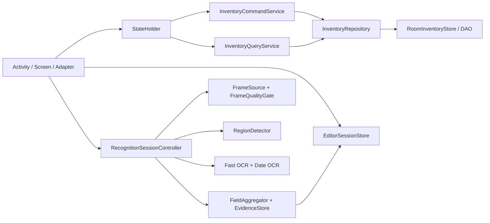

# 食期管家 V2 代码迁移地图

日期：2026-08-31
状态：`FROZEN FOR IMPLEMENTATION`

## 1. 当前结构判断

代码图包含约 2064 个节点、18812 条边，重构风险评分为 `high (0.85)`。风险主要集中在一个超大 Java 社区，而不是清晰的 UI、数据和识别模块：

- `MainActivity.java`：7115 行，混合导航、页面绘制、表单、筛选、CRUD、条码、Excel、JSON、备份和提醒。
- `DateOcrScanActivity.java`：9428 行，混合相机生命周期、视频回放、预处理、ML Kit、Paddle、条码、时序融合、完成条件、关键帧、诊断和确认 UI。
- 40 个最大的生产类中，日期解析、提醒、文字清洗、识别融合和导入器也已达到 600-1500 行。
- 页面主要由 Java 动态创建，`res/layout` 为空，导致视觉结构、业务状态和事件监听紧密耦合。

知识图的“未引用”结果不能直接用来删 Android 生命周期回调、反射入口和 XML/Manifest 入口；任何删除必须再用 manifest、资源、测试和运行路径核对。

## 2. 目标边界

依赖只能向右。UI 不得直接调用 DAO、导入器、提醒调度器或 OCR 引擎；OCR 不得写库存；导入器只产生预览和命令，不直接替换全库。

## 3. 保留、包裹、重写、删除

### 3.1 保留并加契约测试

| 现有代码 | 处理 | 原因 |
| --- | --- | --- |
| Room database、DAO、entity、`InventorySnapshot` | 保留 | 已有商品、条码、批次、提醒关系和迁移证据 |
| `InventorySnapshotMapper` | 保留后收口 | 是旧 `FoodItem` 与规范化 Room 结构之间的迁移桥 |
| `RoomMigrationBackup` | 保留 | 已有备份、散列和读回校验基础 |
| `DateRules` | 保留后纯化 | `expiryDate` 计算、排序和状态仍是领域核心 |
| `ReminderPolicy` / `ReminderScheduler` | 保留后通过命令服务调用 | 已覆盖智能提醒一次计算需求 |
| `FoodExcelExporter` / `FoodExcelImporter` | 保留 codec，禁止直接落库 | 已有文件格式和错误行解析基础 |
| `FoodJsonTransfer` | 保留 codec，禁止直接落库 | 已有筛选、UUID 和合并预览基础 |
| `CameraXFrameSource` / `LatestFrameProcessor` | 保留并测生命周期 | 已符合预览与最新帧处理的目标方向 |
| 日期解析、文字清洗、识别证据类 | 保留为候选算法库 | 先建立评测，不在 UI 重构阶段同时换算法 |

### 3.2 新增边界

| 新组件 | 单一职责 | 首批测试 |
| --- | --- | --- |
| `InventoryRepository` | 读取快照、按事务提交已验证命令 | 内存 fake 与 Room adapter 契约一致 |
| `InventoryCommandService` | 新增、编辑、补货、减量、用完、删除、导入、恢复 | 所有入口共用日期、数量、UUID 和回滚规则 |
| `InventoryQueryService` | 今日任务、库存分组、搜索、筛选、排序 | 同一快照得到稳定结果，不改变数据 |
| `ValidationResult` / `FieldError` | 一次返回全部字段错误和全局错误 | 错误顺序稳定，UI 可聚焦第一个字段 |
| `FoodDraft` | 手动、识别、补货共享的可编辑草稿 | 日期模式切换不丢另一模式草稿 |
| `EditorSessionStore` | 用 session ID 保存跨相机/依据页的草稿 | 旋转、返回、进程重建后恢复 |
| `RecognitionSessionController` | 识别会话状态与取消，不绘制 UI | 部分结果、重扫、退出、超时状态机 |
| `RecognitionDraft` / `FieldEvidence` | 字段候选、来源、关键帧和采用状态 | OCR 结果不能直接生成库存命令 |
| `RecognitionDebugSession` | 调试日志、关键帧保留策略和分享 | 关闭时不记录原图，分享后可删除 |

首批类暂时留在 `com.shiqi.expirytracker` 包，避免一次性包迁移造成巨大 diff。职责稳定且测试通过后，再按 `domain`、`data`、`recognition`、`ui` 分包。

### 3.3 重写

| 现有区域 | 目标 |
| --- | --- |
| `MainActivity.build*Page` 与 utility page 栈 | `MainActivity` 只保留三项导航、目的地切换和顶层状态；页面使用 XML 与独立 screen/controller |
| `showFoodForm` 及其匿名监听器 | 独立 `FoodEditorActivity` + `FoodEditorStateHolder`，新增/编辑/补货共用 |
| 商品详情和批次动作 | 独立 `ProductDetailActivity`，高频减一和补货外露，删除进入更多操作 |
| `DateOcrScanActivity` | 薄 `RecognitionActivity`，只绑定 preview、overlay、状态和确认页 |
| 识别 Activity 内的帧抽样、ROI、OCR、融合、完成条件 | 分别迁入 controller、quality gate、region detector、recognizer、aggregator |
| MainActivity 内 Excel/JSON/备份 apply 方法 | 只负责选择文件和展示预览，最终提交统一命令服务 |
| 各处直接 `FoodStore.saveFoods` | 统一经 repository + command service 事务写入 |

### 3.4 通过替换后删除

- 四项旧底部导航和独立“扫描”目的地。
- `MainActivity` 内重复的 utility page、表单绘制、筛选弹窗和导入确认实现。
- `BarcodeScanActivity` 的旧 Camera API 页面；条码并入统一 RecognitionActivity 的模式。
- 普通相机页面里的原始文字、帧号、耗时和内部诊断按钮。
- 依赖“日期必须识别成功才能完成”的旧完成条件。
- 导入/恢复中先改内存列表再尝试保存的半事务路径。
- 经过 manifest、反射、测试和运行核对后确认无入口的帮助类；不得只依据静态图自动删除。

## 4. 页面实现切片

### Slice UI-0：资源和状态，不改现有入口

- 新增颜色、尺寸、文字和 XML 组件资源。
- 新增 `TodayViewState`、`InventoryViewState`、`SettingsViewState`。
- 用当前快照生成状态，做纯 Java 测试。
- 不删除旧页面，不改数据库。

### Slice UI-1：三项壳与只读页面

- MainActivity 只切换今日、库存、设置三页。
- 库存使用稳定列表容器；搜索和筛选状态进入 state holder。
- 截图对齐静态原型后再开放写操作。

### Slice UI-2：统一编辑器与详情

- 新增、编辑、补货都创建 `FoodDraft`。
- 返回、取消、拍照、查看依据均通过 session ID 恢复。
- 保存只产生 command；验证失败留在原页并一次显示全部错误。

### Slice UI-3：设置与数据工具

- 提醒、JSON、Excel、备份独立页面。
- 导入必须经过预览、备份、事务、读回、结果五个状态。

## 5. 识别实现切片

### Slice OCR-0：评测先行

- 将用户视频和公开样本转成同一 replay source。
- 每个样本保存字段真值、可见文本、首字段时间、最终候选和拒绝理由。
- 未有字段级基线前不换模型。

### Slice OCR-1：拆帧与 UI

- Activity 仅接收 `RecognitionUiState`。
- Controller 管理 frame source、取消、字段完成和关键帧。
- 视频与相机共享同一 frame source 接口和后续管线。

### Slice OCR-2：快速区域与中文通道

- 每帧只做廉价清晰度、曝光、运动和文字区域检测。
- 只保留更优关键帧；ML Kit 中文 bundled 模型跑包装文字区域。
- 条码扫描并行，不阻塞文字识别。

### Slice OCR-3：日期专用慢通道

- 对日期候选 ROI 执行 CLAHE、顶帽/黑帽、局部阈值和少量方向分支。
- Paddle 只处理高价值 ROI；任何新模型必须在相同样本上显著提升字段召回才保留。
- 日期推理执行生产日期不得晚于今天、两个无标签日期按先后判断、单日期按当前时间判断，但低置信度仍不预选。

## 6. 每个切片的硬门槛

1. 开始前固定允许文件和不改范围。
2. 先写状态/领域测试，再接 UI 或模型。
3. 执行 `git diff --check`、本地 Java tests、Gradle unit/lint/assemble。
4. UI 节点必须生成 360x640、360x800 与密度归一化截图并人工查看。
5. 数据节点必须跑旧版本快照升级、重复导入、强制失败回滚和重启读回。
6. 识别节点必须输出字段级报告，不能用“检测到框”代替识别成功。
7. 单个 PR 只包含一个切片；通过后 squash 合并并删除远程分支。

## 7. 第一实施节点 D0

允许文件：新领域类、`FoodStore`/`RoomInventoryStore` adapter、相关本地与 Android 测试；暂不改 UI、OCR、schema 和导入文件格式。

验收：

- 新增、编辑、补货、减量、用完和删除由一个 service 返回结构化结果。
- 名称、数量、日期、批次 UUID 和条码关系一次校验。
- 手动、OCR、Excel、JSON 以后只需把草稿转换成同一 command。
- fake repository 下测试全部通过；Room adapter 仍保留事务和读回校验。
- 当前 APK 行为在接入 service 前保持不变。
