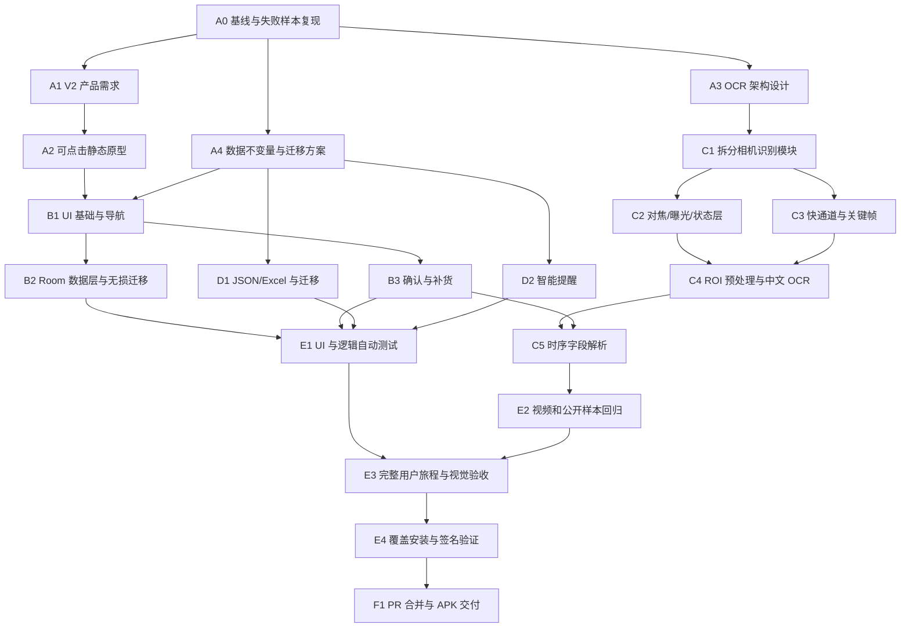

# 食期管家 V2 重构实施计划

日期：2026-07-30
执行约束：当前任务不启用子智能体；任务图保持可并行，但由当前线程按优先级持续推进。

## 1. 完成定义

每个任务节点都必须走完以下流程，不能只提交代码：

1. 开发：在独立分支或工作树完成最小范围实现。
2. 静态检查：`git diff --check`、编译和相关 lint。
3. 自动测试：新增或更新单元、集成或仪器测试。
4. 视觉检查：涉及界面时必须在 720x1280、1080x2400 和至少一个宽屏尺寸截图检查。
5. 用户流程：涉及交互时按真实用户路径点击一遍。
6. 数据检查：涉及存储时执行升级、回滚、重复导入和断电/异常路径。
7. 上传：提交、推送、建立 PR，PR 写清摘要、文件、测试、截图、风险和未覆盖项。
8. 合并：CI 和验收通过后 squash 合并并删除远程分支。

任何节点缺少测试或视觉证据，只能标记 `PARTIAL`。

## 2. 任务图

## 3. 调度算法

使用“拓扑排序 + 关键路径优先的列表调度”：

1. 用 Kahn 算法维护入度为 0 的任务池。
2. 对每个任务计算从该点到终点的最长剩余路径长度。
3. 任务池按“关键路径长度、风险、是否解锁其他节点、预计耗时”排序。
4. 同优先级时先做预计耗时较长的任务，减少尾部等待。
5. 每完成一个节点，降低后继节点入度并重新计算任务池。

当前关键路径：

`A0 -> A3 -> C1 -> C2/C3 -> C4 -> C5 -> E2 -> E3 -> E4 -> F1`

截至 2026-07-31，A0-A7、B1、C2、C3a、D1a、D1b、C1a、D1c 和 B2 已通过。B2 已将 schema 0/2/3 的 SharedPreferences 库存无损迁移到 Room schema 1；221 项既有逻辑测试、5 项管线测试、9 项编辑器测试、29 项快照映射测试、5 项 Android 仪器测试，以及覆盖升级、CRUD、Excel/JSON、失败回滚、重启和视觉验收均通过。AVD 实时相机冻结与真机光学能力保留到 C1b；证据见 `docs/qa/2026-07-31-redesign-v2-b2-room-migration.md`。

当前无入度任务池按关键路径优先排序：

- `C1b 真实相机与对焦反馈`：在真实 Android 手机上完成预览、AF/AE/AWB、点按/自动恢复、P50/P95、持续帧率、温升和能力缺失降级；AVD 冻结不能作为通过证据。
- `D1d 其余业务页面迁移`：继续迁移扫码查找选择和设置内的业务页面。
- `C3/C4 字段指标与定向补扫`：在冻结样本通过基础上完成公开集统计和缺失字段补扫。

静态原型、模拟器或视频回放都不能替代真实相机门槛；每个后续节点仍必须独立走完开发、测试、视觉、数据、上传流程。

## 4. 节点清单

| 节点 | 开发内容 | 必须测试 | 上传门槛 |
| --- | --- | --- | --- |
| A0 | 冻结主线、建立独立工作树、复现 2026-07-29 视频 | 视频元数据、模拟器回放、日志与关键帧 | 诊断报告能区分定位/OCR/字段/填入 |
| A1 | 产品边界、用户、信息架构、流程、指标 | 与现有数据模型和用户需求逐条核对 | PRD 无冲突且明确非目标 |
| A2 | 总览、库存、扫描、确认、补货、设置可点击原型 | Playwright 桌面/手机截图、点击路径、文本溢出 | 用户能从扫描走到确认和补货 |
| A3 | 双通道 OCR、模块边界、状态机、模型准入 | 架构走查、失败样本逐根因映射 | 不依赖整帧逐帧 OCR，不按品类丢名称 |
| A4 | 商品/条码/批次/提醒 schema 与迁移 | 老版本快照升级、幂等导入、失败回滚 | 覆盖安装数据 100% 保留 |
| B1 | Android 主题、尺寸、导航和公共组件 | Robolectric/仪器导航测试、三尺寸视觉检查 | 48dp 触控和返回栈通过 |
| B2 | Room 规范化数据层、旧 SharedPreferences 无损迁移与私有备份 | schema 0/2/3、幂等、读回校验、失败回滚、CRUD、Excel/JSON、重启 | 覆盖升级数据与旧 payload 散列不变，schema JSON 和仪器测试通过 |
| B3 | 关键帧确认、字段证据、已知条码补货 | 草稿恢复、返回栈、冲突字段、不同批次 | 打开识别依据后可无损返回 |
| C1 | 从超大 Activity 拆出帧源、调度、识别和字段模块 | 旧视频回归、生命周期和取消测试 | 无功能丢失、无帧资源泄漏 |
| C2 | 连续 AF、点按对焦、AE/AWB、曝光与统一状态 | 真机焦点日志、能力缺失设备降级 | 预览可见、状态不矛盾 |
| C3 | 最新帧快通道、区域框、条码、字段关键帧 | P50/P95 延迟、只保留最新帧、框坐标 | 预览 >=24fps，UI 反馈 <=500ms |
| C4 | 日期 ROI、CLAHE/黑帽/顶帽/阈值、中文模型 A/B | 用户样本、510-Date、ExpDate、低对比度集 | 仅保留显著提升模型，APK <1GB |
| C5 | 跨帧稳定、日期推理、名称排序和完成条件 | 日期格式矩阵、未来生产日期拒绝、药品名称回归 | 错误日期不预选，部分结果可继续扫描 |
| D1 | JSON 快速同步、Excel 批量、分享和 UUID 更新 | 时间筛选、重复导入、错误行、整批回滚 | QQ/微信分享面板可达 |
| D2 | 固定/智能提醒和一次计算规则 | 新增、开封、保存状态变化、重启 | 无状态变化时提醒日期不漂移 |
| E1 | 全量 Java、Android 和 UI 自动测试 | 单元、集成、仪器测试全部通过 | 无跳过关键测试 |
| E2 | 所有用户视频和公开样本批量评测 | 字段召回、误填率、首结果耗时 | 每个样本有可审计结果 |
| E3 | 中老年视角完整增改删、扫描、补货、导入导出 | 录屏、截图、触控、返回栈、错误恢复 | 视觉和流程均 `PASS` |
| E4 | 固定签名覆盖安装、迁移、卸载边界 | 老 APK -> 新 APK 覆盖、数据对比 | 无签名冲突且数据不丢 |
| F1 | 整理 PR、CI、squash 合并、APK 和校验值 | CI、安装、启动、版本信息 | 提供可安装 APK 和 SHA-256 |

## 5. 里程碑

### M0 设计冻结

完成 A0-A3。交付 PRD、OCR 架构、任务图和可点击原型。未经视觉确认，不进入全面 Android 页面替换。

### M1 数据与 UI 骨架

完成 A4、B1-B3、D2。新版主流程可用，旧数据可迁移，识别仍可暂接旧后端但必须走新确认页。

### M2 相机识别重构

完成 C1-C5。以字段级结果和延迟验收，停止使用“画框数量”作为能力证明。

### M3 数据交换与全量 QA

完成 D1、E1-E4。执行真实用户完整流程、Excel/JSON、覆盖安装与签名检查。

### M4 发布

完成 F1。仅当所有硬门槛通过时合并并交付 APK。

## 6. 风险控制

- 真机对焦不能被视频回放替代，C2 和 E3 必须有真实手机证据。
- 公开日期集多数偏英文或裁剪图，不能代替中文包装真机集。
- 模型官方指标不能直接推导本项目效果，必须执行相同样本 A/B。
- UI 与 OCR 分支要分阶段合并，避免一个 PR 同时包含不可审查的大量变化。
- 主仓库已有用户修改时不得覆盖；所有重构在独立工作树进行。
