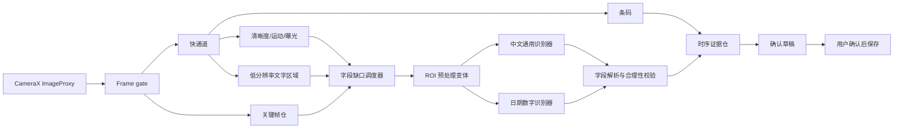
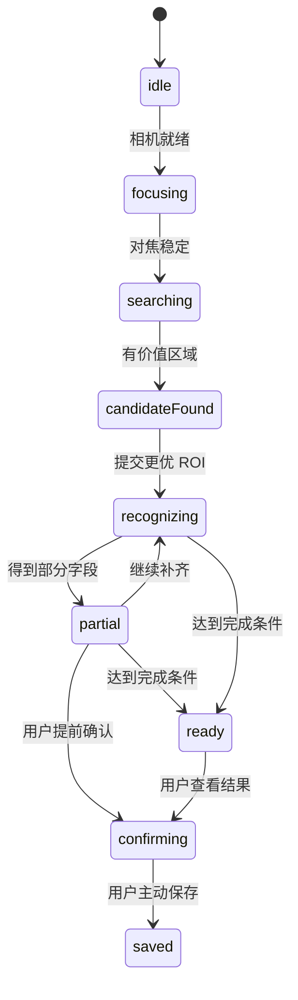

# 食期管家 V2 相机与 OCR 系统设计

状态：架构提案
日期：2026-07-29

## 1. 设计目标

V2 识别系统要解决两个不同问题：

1. 在包装上快速定位所有可能有价值的文字、条码和日期区域。
2. 对中文包装文字以及喷码、拓印、激光打印的低对比度日期进行可靠识别和字段推理。

“画框”只表示定位成功，不代表文字识别、字段解析或草稿填入成功。界面必须分别表达这四个阶段。

## 2. 失败视频复盘

输入：

`Record_2026-07-29-18-13-34_e7c84e4b72b45d7acf770bbb7219e5ff.mp4`

基础信息：

- 时长约 32.86 秒。
- 画面 720 x 1584。
- 平均约 47.44fps。
- 录屏内容包含旧版相机预览和旧版识别状态覆盖层。

模拟器回放结果：

- 处理 5 个入选帧，总耗时约 91.47 秒。
- OCR 读到了“复方硫酸软骨素滴眼液”和“用于视疲劳，干眼症”。
- 条码读到 `6917246211883`。
- 最终草稿仍是 `name=false, dates=false, barcode=true`。
- 一个完整 OCR 帧最高耗时约 17.94 秒，单次识别曾耗时约 10.27 秒。

结论：这是一个可复现的系统性失败，不只是“模型没看见”。

## 3. 根因

### 3.1 语义过滤错误

旧清洗器以食品为中心，把药品名称当成无效文本。OCR 已经成功，字段提升阶段却把结果丢掉。

修正：产品域扩展为家庭保质期物品。商品名过滤只排除界面文案、说明句、纯追溯码和明显噪声，不按食品、药品、个护类别硬编码拒绝。

### 3.2 帧和裁剪预算被错误区域占用

录屏回放使用固定比例裁剪，旧界面的状态文字仍留在预览里。高对比度界面字和长追溯码更容易获得高分，挤占真正包装日期的检测与识别槽位。

修正：

- 真相机分析直接使用 `ImageProxy`，不会把 UI 覆盖层合成进输入。
- 屏幕录制回放必须使用明确的相机内容区域和 UI 遮罩。
- 识别槽位按字段分配，日期区域拥有保底预算，不能完全按通用对比度排序。

### 3.3 旧帧排队

完整 OCR 太慢，分析结果到达时画面已经变化。用户看见的是当前预览，系统处理的是很久以前的帧。

修正：CameraX 使用 `STRATEGY_KEEP_ONLY_LATEST`，快速通道和慢速通道都只保留一个最新待处理任务。任何 `ImageProxy` 必须及时关闭。

### 3.4 成功条件错误

旧界面把“发现文字区”表现得像识别成功，但字段仍为空。状态机还可能同时显示“识别中”和“已完成”。

修正：统一由 `RecognitionSessionController` 发布单一状态，UI 不直接拼接模型状态。

## 4. 总体架构



建议拆分模块：

| 模块 | 职责 |
| --- | --- |
| `CameraFrameSource` | CameraX 生命周期、旋转、分辨率、缩放和帧释放 |
| `FrameQualityAssessor` | 清晰度、运动、曝光、反光、字符像素高度 |
| `TextRegionDetector` | 输出全部文字区域，不做字段推理 |
| `BarcodeRecognizer` | 条码解码和跨帧稳定 |
| `KeyFrameStore` | 每个字段保留少量更优帧 |
| `RecognitionScheduler` | 根据字段缺口决定哪些 ROI 进入慢通道 |
| `TextLineRecognizer` | 中文通用文本识别 |
| `DateRoiRecognizer` | 日期、批号和短数字串识别 |
| `FieldExtractor` | 名称、生产日期、保质期、有效期和批号解析 |
| `TemporalEvidenceStore` | 跨帧聚合、冲突和稳定性 |
| `RecognitionSessionController` | 唯一状态机与 UI 输出 |
| `ConfirmationDraft` | 可编辑草稿、证据和来源 |

旧的超大 `DateOcrScanActivity` 不再同时承担相机、模型、规则、状态和 UI。

## 5. 双通道实时处理

### 5.1 快通道

每次只处理最新帧，目标耗时低于 80ms：

- 计算 Laplacian/梯度清晰度和运动量。
- 估计曝光、局部反光和低对比度区域。
- 运行条码解码。
- 在缩小图上运行文字区域检测，更新屏幕框。
- 估算文字高度；低于约 16px 时提示靠近或缩放。

快通道不运行全图文字识别。

### 5.2 慢通道

只有满足以下任一条件才运行：

- 某字段还缺失，当前 ROI 比该字段历史最佳帧更清楚。
- 新区域的形状、邻近关键词或字符结构更像日期。
- 条码或商品正面首次稳定，需要读取商品名称。
- 用户点按一个区域要求优先识别。

慢通道只处理 ROI，不处理整帧。新任务到来时覆盖尚未开始的旧任务，不建立长队列。

### 5.3 字段预算

每轮最多选择少量 ROI，并为字段预留槽位：

- 日期候选至少 2 个。
- 商品名候选至少 1 个。
- 关键词邻域至少 1 个。
- 其余槽位按信息增益排序。

长条码、追溯码和 UI 文案不能占用日期保底槽位。

## 6. 关键帧选择

通用清晰度不能单独决定关键帧。每个 ROI 使用字段相关评分：

```text
score =
  0.28 * normalizedSharpness +
  0.18 * localContrast +
  0.16 * stableGeometry +
  0.14 * expectedCharacterHeight +
  0.14 * fieldLikelihood +
  0.10 * newInformation
  - glarePenalty
  - motionPenalty
  - duplicatePenalty
```

日期 ROI 的 `fieldLikelihood` 来自：

- 数字、分隔符、年月日、EXP、MFG、BBE、LOT 等局部结构。
- 附近“生产日期、保质期、有效期至、限用日期”等中文关键词。
- 一行 6 至 10 位日期样式。
- 两个时间上有序且范围合理的日期。

商品名 ROI 更重视大字号、包装正面上部、跨帧重复和中文名词结构。说明句、功效句、公司地址、执行标准和纯数字串降权。

## 7. 低对比度日期

喷码、拓印和激光打印常见问题包括局部对比度低、背景纹理、曲面反光、字符断裂和运动模糊。不能只对整图做一次固定阈值。

每个日期 ROI 生成有限的互补变体：

1. 原图与灰度图。
2. 光照归一化后的 CLAHE。
3. 黑帽变换，突出暗字浅底。
4. 顶帽变换，突出亮字深底。
5. 自适应阈值，处理不均匀光照。
6. 必要时对小 ROI 做 2x 文本超分辨率。

变体先由便宜的结构评分筛选，再进入 OCR。不同变体的输出通过字符级一致性和日期合理性融合，而不是任意选择置信度最高的一条。

研究表明，低对比度工业文字同时受到不均匀照明、腐蚀/断裂字符和复杂背景影响；药盒压印日期的有效方案也倾向先做专用浅层特征定位和图像融合，而不是直接把整张图交给通用 OCR。

## 8. 模型策略

应用允许较大，但只保留能显著改善样本的模型。

### 8.1 候选组合

| 能力 | 候选 | 用途 |
| --- | --- | --- |
| 即时中文兜底 | ML Kit bundled Chinese | 模型随 APK 到位，避免首次下载期间空结果 |
| 条码 | ML Kit bundled barcode | 快通道 |
| 文字定位 | PP-OCRv5 mobile det 与现有 PP-OCRv6 small det A/B | 包装多方向文字区域 |
| 中文识别 | PP-OCRv5 mobile rec | 通用中文包装文字 |
| 日期识别 | 轻量数字/日期专用识别器 | 喷码、压印、激光日期 ROI |

PP-OCRv5 官方复杂评测相对 v4 有明显提升，移动识别模型覆盖简体中文、繁体中文、英文、日文、拼音和复杂字形；但官方也明确指出 v5 字典更大、推理更慢。因此不能仅凭版本号替换，必须在本项目样本和目标手机上比较准确率、延迟、内存与 APK 体积。

### 8.2 模型准入门

模型只有同时满足以下条件才进入 APK：

- 对用户视频和固定公开验证集的字段召回有可重复提升。
- 错误日期自动填充不增加。
- 中端手机 P95 ROI 延迟在预算内。
- 峰值内存不会导致相机预览卡顿。
- 模型和字典许可允许分发。

没有明显收益的 server 模型、重复检测器和研究模型不打包。

## 9. 相机与对焦

- CameraX 保持连续自动对焦。
- 预览中央区域默认设置 AF/AE/AWB 测光。
- 用户点按文字或日期框时，使用 `FocusMeteringAction` 对该点重新对焦和测光。
- 自动取消一次性锁定后恢复连续对焦，避免长期锁死。
- 根据设备能力开放曝光补偿；不支持时隐藏控制。
- 反光时优先提示改变角度，不默认常亮手电筒。
- 支持设备才启用低光增强；能力必须运行时检测。
- 对焦未稳定时可以定位区域，但不把模糊帧送入慢通道。

视频回放只能验证帧选择、OCR 和字段逻辑，不能证明真实相机对焦已经通过。

## 10. 状态机



UI 映射：

| 状态 | 用户看到的文案 |
| --- | --- |
| `focusing` | 正在对焦，请保持稳定 |
| `searching` | 对准商品正面或日期 |
| `candidateFound` | 已找到有用文字 |
| `recognizing` | 正在读取更清楚的区域 |
| `partial` | 已识别部分信息，可继续扫描 |
| `ready` | 信息已齐，可以核对 |

诊断信息通过单独测试版导出，不进入普通用户界面。

## 11. 字段推理

### 11.1 日期

- 有“生产日期/MFG/DOM”标签时，解析为生产日期候选。
- 有“有效期至/EXP/USE BY/BBE”标签时，解析为最终日期候选。
- 有“保质期/质保期/shelf life”时，解析数值和天、月、年单位。
- 两个无标签日期：较早日期优先生产日期，较晚日期优先有效期。
- 一个无标签日期：晚于当天优先有效期；不晚于当天优先生产日期。
- 生产日期晚于当天、月份超 12、日期超月末、年缺失且无法可靠推断时，不得预选。
- 月份型有效期只在业务格式明确时解释为该月末日。
- 直接有效期与生产日期加保质期冲突时，保留两条证据并要求核对。

### 11.2 商品名

名称选择综合：

- 字体面积和位置。
- 跨帧稳定性。
- 条码历史档案。
- 类别词典和短语结构。
- 是否属于说明、功效、成分、公司或标准信息。

确认页只给一个主推荐。低置信文本不组成一长串名称候选。

## 12. 测试与指标

验证集分层：

1. 用户提供的全部视频和图片。
2. 本次失败录屏的可读字段和字段丢弃回归。
3. 510-Date、ExpDate 和 Products-Real 等公开日期数据。
4. 中文包装 OCR 数据和 Real-CE 中文低分辨率文字集。
5. 真机采集的食品、药品、个护和耗材场景。

核心指标：

- 文字区域召回。
- 商品名、生产日期、保质期、有效期、条码的字段级召回。
- 错误自动填充率。
- 首个可用字段时间。
- 达到确认条件时间。
- 快通道和慢通道 P50/P95 延迟。
- 丢旧帧数量与峰值内存。

“框很多”“FPS 很高”都不能替代字段级验收。

## 13. 参考资料

- [ML Kit Android text recognition](https://developers.google.com/ml-kit/vision/text-recognition/v2/android)：中文 bundled/unbundled 模型、字符像素和实时处理建议。
- [CameraX ImageAnalysis](https://developer.android.com/media/camera/camerax/analyze)：`STRATEGY_KEEP_ONLY_LATEST` 与分析队列行为。
- [CameraX configuration](https://developer.android.com/media/camera/camerax/configuration)：曝光补偿与设备能力。
- [CameraX FocusMeteringAction](https://developer.android.com/reference/androidx/camera/core/FocusMeteringAction)：AF/AE/AWB 对焦与自动取消。
- [PP-OCRv5](https://www.paddleocr.ai/main/en/version3.x/algorithm/PP-OCRv5/PP-OCRv5.html)：复杂中文、多文本类型和速度权衡。
- [PaddleOCR mobile deployment](https://github.com/PaddlePaddle/PaddleOCR/blob/main/deploy/lite/readme.md)：移动端检测与识别模型部署参考。
- [Industrial Scene Text Detection](https://arxiv.org/abs/2110.12663)：低对比度、不均匀照明和复杂背景下的文字定位。
- [Low contrast stamped dates](https://doi.org/10.1016/j.dsp.2024.104602)：药盒压印日期的浅层特征定位与图像融合。
- [Product code recognition review](https://pmc.ncbi.nlm.nih.gov/articles/PMC10521108/)：包装材质、反光、曲面、低对比度和运动模糊问题。
- [ExpirationDate dataset](https://huggingface.co/datasets/dimun/ExpirationDate)：Products-Real/Products-Synth 日期区域与转录。
- [Efficient Expiration Date Recognition](https://www.mdpi.com/1999-4893/18/5/286)：移动端日期检测、DMY 拆分、13 种格式和 ExpDate/510-Date。
- [Real-CE](https://openaccess.thecvf.com/content/ICCV2023/html/Ma_A_Benchmark_for_Chinese-English_Scene_Text_Image_Super-Resolution_ICCV_2023_paper.html)：中文场景文字超分辨率评测。

## 14. C1 实施状态

已实现：

- `PackagingNamePolicy`：家庭包装物品的统一名称门禁。
- `RecognitionFieldPromoter`：原始文字、语义候选、条码/日期约束和字段晋升。
- 完成阶段强名称防回退。
- 文字已见、候选数量和字段晋升的分层诊断。
- 指定失败视频从结果页进入新增表单的完整视觉回归。

指定视频已经从旧基线的 `name=false` 修复为稳定商品名 `复方硫酸软骨素滴眼液`，但最终回放仍约 41.33 秒。下一阶段优先做：

1. 把帧质量、文字区域检测和 ROI 调度从 `DateOcrScanActivity` 继续拆出。
2. 快通道只做最新帧、低分辨率定位和字段缺口判断。
3. 慢通道只复识更优 ROI，并为日期和商品名保留独立预算。
4. 对 CLAHE、黑帽、顶帽和自适应阈值变体先做便宜筛选，再进入 OCR。
5. 在全部用户样本与公开日期集上比较现有 PP-OCRv6 small 和 PP-OCRv5 mobile；没有显著字段收益的模型不进入 APK。

本轮状态是字段晋升 `PASS`，完整识别性能、低对比度日期和真实相机仍为 `PARTIAL`。
