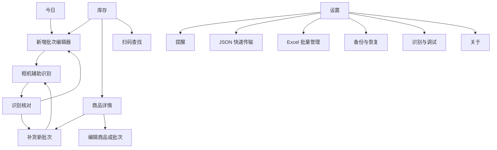
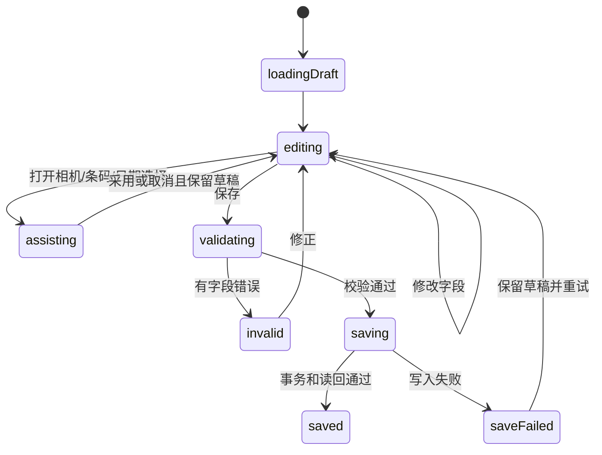
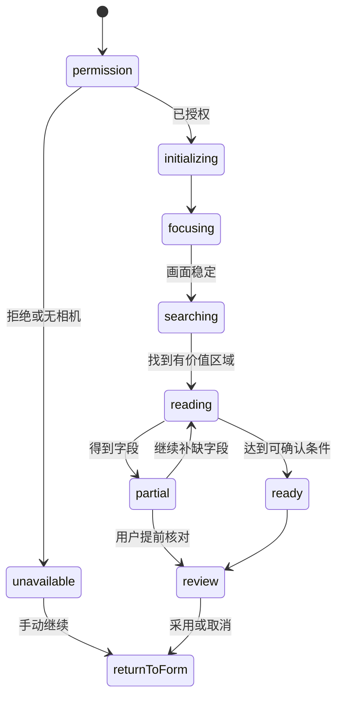

# 食期管家 V2 系统蓝图

状态：设计草案，待可点击原型视觉验收后冻结  
日期：2026-08-31  
平台：Android 本地 APK

## 1. 设计结论

V2 不是给现有页面换颜色，而是重新规定系统怎样帮助用户完成任务。

1. 一级导航只保留“今日、库存、设置”三个稳定目的地。
2. “新增”是全局任务，不是第四个导航页；手动表单始终可用，相机与条码是表单的辅助输入。
3. 商品档案与批次分离。名称、类别、单位、条码属于商品；日期、数量、保存与开封状态属于批次。
4. 数量状态由数据推导，不允许“剩余 0 件但仍在库”一类矛盾状态。
5. 任何识别结果、联网条码结果、导入结果都先进入可编辑预览，用户确认后才保存。
6. 任何跨页辅助操作都保留原草稿；返回不是重启流程，查看证据也不能清空字段。
7. 高频动作直接可见，低频和破坏性动作收进明确菜单；即时减量必须支持撤销。
8. 数据迁移、覆盖导入和恢复必须执行“备份、写入、读回校验”完整事务。
9. 识别成功以形成可用字段为准，不以出现文字框、模型返回或帧率为准。
10. 真机相机、视频回放、静态图片和解析器是四种不同证据，不能互相冒充通过。

## 2. 证据基线

### 2.1 已确认的问题

最新完整手动走查见 `docs/qa/2026-08-12-manual-entry-full-journey-audit.md`，结论为 `FAIL`。以下问题必须全部映射到设计和测试：

| 问题 | 根因 | V2 处理 |
| --- | --- | --- |
| 覆盖导入承诺备份但没有实际备份 | 提示文案与事务实现分离 | 单一导入状态机强制先生成并校验快照 |
| 未来生产日期、0 数量和倒置日期可保存 | 校验散落在表单、导入和存储层 | 统一 `DomainValidator`，所有写入口共享 |
| 减到 0 后总览、库存和提醒互相矛盾 | 状态被多处独立保存 | `remainingQuantity` 与归档标记推导展示状态 |
| 改一个批次名称会拆出新商品 | 商品字段和批次字段边界不清 | 商品档案编辑统一影响其批次，批次字段独立 |
| 复制批次无确认并恢复数量 | 复制被当成写操作而不是草稿 | 改为“以此批次补货”，先生成可编辑新批次草稿 |
| 详情缺备注和开封后日期 | 详情只呈现摘要模型 | 批次详情展示所有用户输入和提醒依据 |
| 筛选项裁切、页面巨大且稀疏 | 横向标签堆叠和固定尺寸布局 | 筛选底部页、紧凑列表、响应式宽度 |
| 冷启动长时间空白 | 首屏等待同步读取且无状态 | 启动画面立即显示骨架或明确加载/失败状态 |
| 错误只使用 Toast | 错误没有字段归属和恢复动作 | 字段内错误、滚动聚焦、保留输入、明确重试 |
| 日期模式切换立即清空值 | 切换同时执行破坏性数据变更 | 保留两种输入草稿，保存时选择生效模式 |
| 首页和详情动作重复 | 按页面堆功能而非按任务分层 | 每个页面只保留一个上下文主操作 |
| 自己导出的 Excel 再导入仍告警 | 导出格式与导入校验定义不一致 | 同一 schema/codec 生成和解析，往返测试 |
| 空库首页过度强调识别 | 把技术能力当成产品主任务 | 手动新增与扫描辅助同等可达，默认进入可填表单 |

### 2.2 视觉检查结论

实际 1080x2400 截图显示：

- 首页同时出现两个扫描入口，用户无法判断“扫描包装并识别”和“开始智能识别”是否不同。
- 库存页的大标题、大“新增”按钮、搜索、筛选和行内操作争夺首屏，状态筛选横向溢出。
- 商品卡片用边框包裹所有内容，详情页又在卡片内重复“减量、编辑、更多、补货、编辑最近批次”。
- 设置和数据页用大面积空白与巨型列表项表达很少的信息，页面层级显得重而操作密度低。
- 识别页把检测框、帧率、耗时、字段状态和主操作一起压在相机预览上；普通用户看到的是内部流水线，不是下一步。
- 核对页把三张关键帧、三个字段和两个底部按钮全部铺开，信息虽完整但缺少“先改哪一项”的优先级。

### 2.3 代码结构风险

- `MainActivity.java` 约 7115 行，同时承担导航、页面构建、表单、导入导出和业务操作。
- `DateOcrScanActivity.java` 约 9428 行，同时承担相机、模型、图像处理、字段推理、回放和 UI。
- 继续在两个 Activity 中追加分支会放大返回栈丢失、状态矛盾和测试困难。

因此 V2 需要先拆状态和业务边界，再替换页面，不能继续只在 Activity 内加条件。

## 3. 用户与任务

### 3.1 主要用户

- 想在手机本地管理食品、药品、个护和家庭耗材的人。
- 同一商品经常补货，且不同批次日期、数量和保存方式不同的人。
- 不愿注册账号、不希望把库存上传云端的人。
- 视力、手部精细操作或技术理解能力一般的中老年用户。

### 3.2 核心任务优先级

| 优先级 | 任务 | 成功标准 |
| --- | --- | --- |
| P0 | 手动新增一个批次 | 不依赖相机，30 秒内可保存，错误可定位 |
| P0 | 查看今天和近期要处理的物品 | 首屏可见名称、日期、数量和处理动作 |
| P0 | 减少、用完、补货 | 不跳转或最多一次跳转，结果可撤销或确认 |
| P0 | 编辑和删除 | 不误改其他批次，不静默丢失内容 |
| P0 | 升级、重启、恢复后数据仍在 | 数量、批次、条码、提醒完全一致 |
| P1 | 相机辅助新增 | 部分识别也能进入编辑器，所有字段可改 |
| P1 | 扫条码查找并补货 | 一个条码可对应多个商品，必须明确选择 |
| P1 | JSON 跨设备传输 | 可筛选、分享、幂等更新、不重复批次 |
| P1 | Excel 批量维护 | 可预览错误行，覆盖失败完整回滚 |
| P2 | 调试识别问题 | 普通界面不暴露内部术语，调试日志可分享 |

## 4. 信息架构

### 4.1 一级结构

| 目的地 | 用户问题 | 内容 |
| --- | --- | --- |
| 今日 | 我现在先处理什么？ | 今天到期、7 天内、已过期、低库存、最近操作 |
| 库存 | 我有什么，在哪里？ | 搜索、筛选、商品与多批次、减量、补货 |
| 设置 | 提醒和本地数据怎样管理？ | 提醒、数据交换、备份、识别、关于 |

全局“新增”按钮在今日和库存页保持相同位置与文案。相机扫描不是一级目的地，因为它是新增、补货和查找中的辅助步骤，离开任务上下文后没有独立价值。

### 4.2 页面图

### 4.3 导航规则

- 只有三个一级页显示底部导航。
- 编辑器、详情、相机、核对、导入预览和设置子页使用全屏页面并隐藏底部导航。
- 系统返回先处理当前页未保存状态，再返回上一个真实页面；不得跳回首页或重新创建相机。
- 相机和系统文件选择器返回时，通过稳定的 `draftId` 恢复同一草稿。
- 进程被 Android 回收后，最少保存 `draftId`、当前步骤、选择模式和未提交字段，重建时从本地草稿仓恢复。

## 5. 领域模型

### 5.1 实体

`ProductProfile`

- 不可变 `productId`
- 名称、类别、默认单位、常用保质期、默认保存位置
- 更新时间与数据版本

`Barcode`

- 标准化码值和格式
- 通过 `ProductBarcode` 与多个商品档案建立多对多关系

`Batch`

- 不可变 `batchId` UUID
- `productId`
- 生产日期、保质期值/单位、最终日期 `expiryDate`
- 总数量、剩余数量、保存位置/状态、开封日期、备注
- 创建时间、导入时间、更新时间、来源

`ReminderPlanSnapshot`

- 批次、提醒模式、计算时输入、结果日期、算法版本
- 只有相关输入改变时重算

`StockEvent`

- 不可变事件 ID、批次、类型、数量变化、变化前后值、时间、来源
- 类型包括新增、消耗、补货、调整、用完、恢复、导入
- `Batch.remainingQuantity` 仍是查询用当前值，但每次变化必须与事件在同一事务写入

`RecognitionDraft`

- 草稿 ID、入口场景、新增/补货目标、当前字段、字段证据、关键帧引用
- 不属于正式库存，用户保存或主动放弃前可以恢复

### 5.2 派生状态

不得在不同模块分别保存“正常、临期、已过期、已用完”。统一由下列顺序推导：

1. 已归档 -> `ARCHIVED`
2. 剩余数量为 0 -> `FINISHED`
3. 没有有效最终日期 -> `DATE_PENDING`
4. `expiryDate` 早于今天 -> `EXPIRED`
5. `expiryDate` 等于今天 -> `DUE_TODAY`
6. 在提醒窗口内 -> `DUE_SOON`
7. 其他 -> `ACTIVE`

提醒、首页统计、库存筛选和通知全部读取同一派生结果。

### 5.3 写入不变量

- 新增和补货的总数量必须大于 0，剩余数量必须在 0 到总数量之间。
- 生产日期不得晚于设备当天。
- 最终日期不得早于生产日期或开封日期。
- 月份、日期、闰年和月末必须有效；模糊年份不得静默猜成确定值。
- 日期缺失是“待补充”，绝不是“永不过期”。
- 同一商品档案的名称、类别和单位编辑后，所有批次通过 `productId` 自动展示新值。
- 批次日期、数量、保存、开封和备注只影响该批次。
- 识别、Excel、JSON、备份恢复和手动表单调用同一验证器。

## 6. 关键用户流程

### 6.1 手动新增

1. 用户点击全局“新增”。
2. 直接进入可填写表单，首屏只要求名称、日期方式和数量。
3. “拍包装识别”“扫条码”和“拍日期”是字段旁的辅助操作，不是进入表单的门槛。
4. 日期支持“生产日期 + 保质期”和“直接填最终日期”；切换只改变当前生效方式，不删除另一方式已输入的草稿。
5. 保存时在字段内显示错误并滚动到第一个错误；修正后仍保留其他内容。
6. 保存成功回到来源页并突出新批次，同时提供“撤销新增”短时操作。

### 6.2 相机辅助新增

1. 从编辑器打开相机，草稿先持久化。
2. 相机只显示“对焦、寻找、读取、已得到部分信息、可以核对”五类用户状态。
3. 条码、商品名和日期独立更新；任何字段出现后，“使用已识别内容”立即可用。
4. 用户也可随时选择“不再识别，继续填写”。
5. 核对页按风险排序：冲突/无效日期、低可信名称、条码，所有字段可直接编辑。
6. 采用结果后返回原编辑器，只覆盖用户明确采用的字段。

### 6.3 补货

1. 从库存行或商品详情点击“补货”。
2. 商品名称、类别、单位和条码只读复用；新批次日期、数量、保存状态为空或使用明确默认值。
3. 页面首屏提供“拍本批次日期”，进入与新增相同的相机状态机。
4. 保存永远创建新批次；只有 JSON 携带相同 `batchId` 时才执行更新。

### 6.4 减量、用完和撤销

- 库存行的减量按钮直接减少最早到期且仍有库存的批次。
- 操作后显示 6 秒撤销条，明确“已从某批次减少 1 件”。
- 减到 0 时状态立即成为已用完，提醒随之取消；撤销后状态和提醒恢复。
- “删除批次”和“删除商品”必须二次确认，并写清影响范围。

### 6.5 JSON、Excel 与恢复

所有导入共用状态：选择文件 -> 解析 -> 预览 -> 用户选择合并方式 -> 创建并校验备份 -> 单事务写入 -> 读回校验 -> 成功。

失败必须落在以下一个可解释结果：

- 文件无法读取：可重新选择。
- 格式或错误行：展示行号、字段和修正建议，不写数据库。
- 备份失败：停止导入，当前数据不变。
- 写入或读回失败：事务回滚，当前数据不变，可分享诊断。
- 重复批次：按 UUID 和版本预览“无变化、将更新、冲突”，不得静默重复。

## 7. 系统状态机

### 7.1 编辑器

### 7.2 相机识别

### 7.3 启动与数据故障

- `LOADING`：立即显示页面骨架和“正在读取本机库存”。
- `READY`：展示本地数据。
- `LOAD_FAILED`：展示重试、打开备份恢复和分享诊断三个动作，不显示假空库。
- 数据迁移失败时不得自动清库；保留旧数据库和迁移前备份。

## 8. 交互与视觉系统

### 8.1 页面层级

- 一级页：小型页标题、摘要、任务列表、底部导航。
- 任务页：标准顶栏、单一主任务、固定底部主操作。
- 选择和危险确认：底部页或对话框，保持来源上下文。
- 不把完整页面包进卡片，也不在卡片内嵌套卡片。

### 8.2 尺寸

- 页面左右边距：16dp；区块间距：20 至 24dp；行内间距：8 至 12dp。
- 主标题 28sp，页面标题 22sp，区块标题 18sp，正文 16sp，辅助信息 14sp。
- 所有触控区域至少 48x48dp；底部主按钮高度 52dp。
- 卡片仅用于重复批次/商品项，圆角不超过 8dp；设置使用分隔列表而不是巨型卡片。
- 360x640 屏幕首屏必须看见页面目的、一个主操作和至少一条真实内容。

### 8.3 色彩

- 中性白和浅灰承载大面积背景，深灰承载文字。
- 蓝色只表示主操作和当前选择，不作为所有装饰背景。
- 绿色表示正常/成功，琥珀表示待核对/临期，红色表示异常/过期，灰色表示已用完/未设置。
- 状态必须同时有文字，不能只依赖颜色。

### 8.4 文案

- 用户界面不出现 ROI、OCR、候选、帧率、P95、置信度等内部术语。
- 用“已找到日期，请核对”替代“日期候选 promoted”。
- 用“画面有些模糊，点一下日期再保持不动”替代“AF 未收敛”。
- 按钮写动作和结果，例如“使用已识别的 2 项”“补货为新批次”。

## 9. 识别系统

### 9.1 任务拆分

识别管线必须把以下阶段分开计时、记录和验收：

1. 相机获取和 3A 对焦/曝光/白平衡。
2. 帧质量和画面信息判断。
3. 文字区与条码定位。
4. 关键帧和字段 ROI 选择。
5. 中文通用 OCR 与日期专用 OCR。
6. 字段解析、跨帧一致性和业务合理性。
7. 用户采用与保存。

出现框只证明第 3 步，不证明第 5、6、7 步。

### 9.2 快慢通道

- 快通道使用 CameraX `STRATEGY_KEEP_ONLY_LATEST`，只做质量、条码和低分辨率文字定位，目标不阻塞预览。
- 慢通道只处理比历史证据更清楚、能补齐字段或由用户点选的 ROI。
- 商品名、日期、条码分别保留最多 2 至 3 张关键帧，避免一类高对比区域耗尽全部预算。
- 对画面文字占比不足、字符高度过小、运动模糊或严重反光，先给拍摄指导而不是重复跑 OCR。

ML Kit 官方指出文字准确率明显依赖分辨率和对焦，字符最好至少约 16x16 像素；实时场景应让文字占据更多画面并控制输入尺寸。因此“怼近但仍不识别”需要同时检查真实焦点状态、字符像素和 ROI 方向，而不是只增加整帧识别频率。

### 9.3 低对比度日期

日期 ROI 根据局部质量有限地产生原图、灰度、CLAHE、黑帽、顶帽和自适应阈值变体。OpenCV 官方说明 CLAHE 通过局部小块均衡并限制噪声放大，自适应阈值适合不均匀照明；这些变体只作为候选，必须通过结构评分和日期规则筛选，不能全部无条件送入模型。

日期字段推理：

- 明确标签“生产日期/MFG/DOM” -> 生产日期候选。
- “有效期至/EXP/USE BY/BBE/最佳食用期至” -> 最终日期候选。
- “保质期/质保期/shelf life” -> 数值与天/月/年单位。
- 两个无标签日期 -> 较早者倾向生产、较晚者倾向最终日期，但必须均为有效日期且顺序合理。
- 一个无标签日期 -> 晚于今天倾向最终日期，不晚于今天倾向生产日期。
- 生产日期晚于今天、月份大于 12、日期超过月末或日期顺序倒置 -> 不预选，只展示待核对证据。

### 9.4 多模型策略

- ML Kit bundled Chinese：立即可用的中文兜底和 A/B 基线。
- PP-OCR 移动检测/识别模型：复杂方向和包装中文主候选。
- 日期专用轻量识别器：仅在日期 ROI 上运行。
- ZXing/ML Kit barcode：条码快通道。

模型只有在固定验证集上带来可重复字段召回提升、没有增加错误日期预填、P95 延迟和内存满足预算且许可允许分发时才保留。APK 总体积上限 1GB，但体积不是模型数量的理由。

### 9.5 调试模式

开启时按会话记录：设备与相机能力、输入尺寸、对焦结果、曝光补偿、帧质量、区域坐标、关键帧替换、各模型耗时与文本、解析和拒绝理由、最终展示字段。默认不保存完整原图；用户明确开启“保留关键帧”后才保存，并在日志页显示占用空间和一键删除。

关闭调试模式时可以通过系统分享面板导出脱敏 ZIP；普通用户界面只显示可行动状态。

## 10. 架构边界

建议按现有 Java/Views 技术栈渐进拆分，不在同一阶段迁移 Compose：

| 层 | 组件 | 责任 |
| --- | --- | --- |
| UI | `TodayActivity/Fragment`、`InventoryActivity/Fragment`、任务页 | 只渲染 `UiState` 并发送用户事件 |
| 状态 | 每个目的地/任务一个 `ViewModel` 或纯 Java state holder | 草稿、加载、错误、导航恢复 |
| 领域 | `InventoryService`、`ValidationService`、`ReminderService`、`ImportService` | 单一业务规则与事务 |
| 数据 | Room repository、backup repository、draft repository | 本地唯一事实来源 |
| 识别 | frame source、quality gate、detector、recognizer、extractor、evidence store | 不依赖页面控件 |

Android 官方架构建议屏幕级状态由独立 state holder 管理，数据层作为离线应用的事实来源，并通过保存状态在重建后恢复。这直接对应当前超大 Activity、返回丢草稿和启动空白问题。

## 11. 质量门槛

### 11.1 易用性

- 新增、减量、补货、编辑、删除、导入和恢复都有成功与失败路径。
- 主要任务不超过三层页面；任何失败页都有下一步和安全退出。
- 中老年走查不要求理解识别术语，文字不裁切，按钮不重叠。
- 触控目标至少 48dp，小正文对比度至少 4.5:1。

### 11.2 数据

- 手动、识别、Excel、JSON、恢复写入共用不变量测试。
- 相同 JSON 批次 UUID 重复导入不重复；冲突必须预览。
- 覆盖导入和恢复在任一步失败后，数据库内容与操作前逐字段一致。
- 旧 APK 覆盖安装到新 APK 后商品、批次、条码、提醒和数量 100% 保留。

### 11.3 识别

- 预览目标至少 24fps，状态反馈不晚于新证据 500ms。
- 清晰常规包装 2 秒内出现首字段，5 秒内可核对；困难日期 12 秒未得到结果时给明确拍摄指导。
- 对人眼在原始帧中可清楚阅读的字段，用户视频字段召回目标至少 90%。
- 错误日期静默预选低于 1%；任何违反日期不变量的结果为 0% 预选。
- 每个样本保存原始可读真值、模型输出、解析结果、首字段时间和最终结论。

## 12. 实施策略

### 12.1 保留

- Room 规范化商品/批次/条码基础、UUID、提醒快照概念。
- JSON/Excel 现有格式中已稳定且有往返测试的字段。
- CameraX、ML Kit、OpenCV、ONNX Runtime 和现有模型作为 A/B 候选，不默认全部继续打包。
- 已完成的日期、数量、导入回滚规则修复，经复核后迁入统一领域服务。

### 12.2 重写

- 一级导航、首页、库存、商品详情、编辑器、设置和数据页。
- `MainActivity` 内页面状态与业务操作，拆为目的地状态和领域服务。
- `DateOcrScanActivity` 的调度、UI 状态和字段提升，按识别阶段拆分。
- 导入、恢复、减量与补货写入路径，统一事务与事件记录。

### 12.3 删除

- 重复扫描入口、重复详情动作和水平溢出的状态按钮组。
- 以“无过期时间”代替日期未识别的默认行为。
- 只用 Toast 的表单错误、打开辅助页即销毁草稿、看到文字框就显示成功。
- 正式界面中的帧率、模型耗时、候选数量和调试覆盖层。

## 13. 调研依据

- [Android 离线优先数据层](https://developer.android.com/topic/architecture/data-layer/offline-first)：关键功能应不依赖网络，本地数据源承担事实来源。
- [Android UI state holders](https://developer.android.com/topic/architecture/ui-layer/stateholders)：屏幕状态、事件和跨重建恢复应由状态持有者管理，而不是散落在控件回调。
- [Android CameraX ImageAnalysis](https://developer.android.com/reference/androidx/camera/core/ImageAnalysis)：实时分析可使用只保留最新帧策略避免旧帧队列。
- [CameraX 对焦与测光](https://developer.android.com/media/camera/camerax/configuration)：点按对焦通过 AF/AE/AWB 测光点执行，设备能力需要运行时判断。
- [ML Kit 中文文字识别](https://developers.google.com/ml-kit/vision/text-recognition/v2/android)：bundled 模型可立即使用，输入焦点、字符像素和处理尺寸直接影响准确率与速度。
- [OpenCV CLAHE](https://docs.opencv.org/4.x/d5/daf/tutorial_py_histogram_equalization.html)、[自适应阈值](https://docs.opencv.org/4.x/d7/d4d/tutorial_py_thresholding.html)与[形态学](https://docs.opencv.org/4.x/d9/d61/tutorial_py_morphological_ops.html)：用于有限的低对比度日期 ROI 变体。
- [PP-OCRv5 官方文档](https://www.paddleocr.ai/main/en/version3.x/algorithm/PP-OCRv5/PP-OCRv5.html)：作为移动中文复杂文本 A/B 候选，不能只凭版本号替换。
- [Android Views 无障碍](https://developer.android.com/guide/topics/ui/accessibility/views/apps-views)：交互目标至少 48dp，并为控件提供可理解描述。
- [Food Expiration Dates 原始仓库](https://github.com/lorenzovngl/FoodExpirationDates)：以到期日排序、手动增改删、条码和提醒的简单任务骨架。
- [Friskr 原始仓库](https://github.com/vardirhq/friskr)：手动与条码并行、日期扫描、库存位置、用完/丢弃和隐藏诊断模式。
- [Stash 原始仓库](https://github.com/eigger/stash)：扫码补货/消耗、低库存、到期日和详情内直接编辑的高频工作流。

这些同类项目提供任务模式参考，不作为准确率或易用性通过证据；最终结论必须来自本项目原型、自动测试、用户视频和真机走查。
